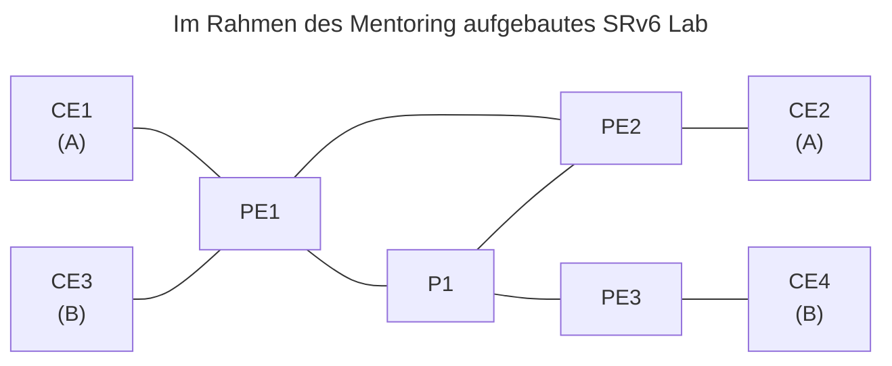

---
date:
  created: 2026-10-26
authors:
- nicof2000
readtime: 5
categories:
- Network
---

# DENOG Mentoring-Programm

Anfang 2026 wurde ich Mitglied im [DENOG e. V.](https://www.denog.de/), die technische Internet & Netzwerk Community,
zur Förderung einer unabhängigen und offenen Plattform zum Austausch von Erfahrungen, Standards und Entwicklungen.

Als Mentee durfte ich in der zweiten Runde des Mentoring-Programm teilgenommen. Das Programm umfasste verschiedene
Themen, die sowohl für die persönliche als auch für die berufliche Entwicklung relevant sind.

<!-- more -->

Neben dem klassischen Network Engineering, welchen ich als Schwerpunkt festgelegt habe, bietet die DENOG Unterstützung
in den Themenbereichen Leadership / Führung, Business Development, Marketing, Projektmanagement, Karriereplanung,
IT-Sicherheit, Softwareentwicklung und Programmierung, Public Speaking und Präsentation sowie Zeit- und Selbstmanagement.

<!-- https://docs.google.com/forms/d/e/1FAIpQLSfBDk-LJIh8_1f7C2lV5XizKHC-iA290jvgHao25i3PtjjlEA/viewform -->

Zum Auftakt fand eine gemeinsame Vorstellungsrunde mit allen Mentees statt. Dabei wurden die Ziele des Programms erläutert
und die Erwartungen an die Teilnehmenden kommuniziert.

Im Mentoring behandelten wir ein breites Spektrum technischer Themen. Den Einstieg bildeten die Routing-Verfahren
Distance Vector und Link State sowie die Protokolle OSPF[^1] und IS-IS[^2]. Anschließend betrachteten wir VPLS[^3]
und ordneten die Technologie historisch ein, um die Entwicklung hin zu EVPN[^4] nachvollziehen zu können.

Weitere Schwerpunkte waren MPLS[^5], LDP[^6] und Traffic Engineering, darunter RSVP[^7] und PCE[^8]. Mit SRv6[^9]
widmeten wir uns einer modernen Weiterentwicklung des Segment Routings. Die theoretischen Inhalte ergänzten wir durch
den gemeinsamen Aufbau eines Labs mit FRR unter Linux.

Darüber hinaus beschäftigten wir uns mit VPP[^10] und dessen Einsatz für L2VPN, EVPN und MACsec. Ein weiterer Themenbereich
umfasste Verfahren für den Umgang mit IPv4- und IPv6-Netzen: CGNAT[^11], DS-Lite, MAP-T, MAP-E, NAT64 mit DNS64 sowie NPTv6.

Das Mentoring verband damit technische Grundlagen, die Einordnung aktueller Technologien und praktische Übungen. Besonders hilfreich
war für mich, die einzelnen Themen im direkten Austausch zu vertiefen und theoretische Inhalte im Lab anzuwenden.

Das Mentoring hat mir fachlich sehr viel gebracht. Ich kann das Programm allen empfehlen, die sich für Netzwerktechnik interessieren
und ihr Wissen in diesem Bereich vertiefen möchten.

Mein besonderer Dank gilt meinem Mentor für die engagierte Begleitung, den offenen Austausch und die wertvollen Einblicke in die
behandelten Themen. Ich habe die gemeinsame Zeit sehr geschätzt und konnte viel aus dem Mentoring mitnehmen.

Mein besonderer Dank gilt meinem Mentor für die engagierte Begleitung, den offenen Austausch und die wertvollen Einblicke in die
behandelten Themen. Ich habe die gemeinsame Zeit sehr geschätzt und viel aus dem Mentoring mitgenommen. Ebenso danke ich dem DENOG
e. V. für die Organisation des Mentoring-Programms und die Möglichkeit, daran teilzunehmen.

Das Engagement für die Community zeigt sich auch in der [Welcome Working Group](https://www.denog.de/de/wg.html), die neue Mitglieder
willkommen heißt.

---

[^1]: OSPF: Open Shortest Path First
[^2]: ISIS: Intermediate System to Intermediate System
[^3]: VPLS: Virtual Private LAN Service
[^4]: EVPN: Ethernet VPN
[^5]: MPLS: Multiprotocol Label Switching
[^6]: LDP: Label Distribution Protocol
[^7]: RSVP: Resource Reservation Protocol
[^8]: PCE: Path Computation Element
[^9]: SRv6: Segment Routing v6
[^10]: VPP: Vector Packet Processing
[^11]: CGNAT: Carrier-grade Network Address Translation
