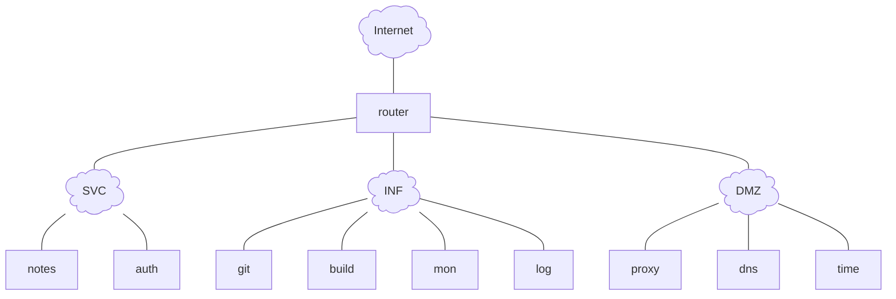
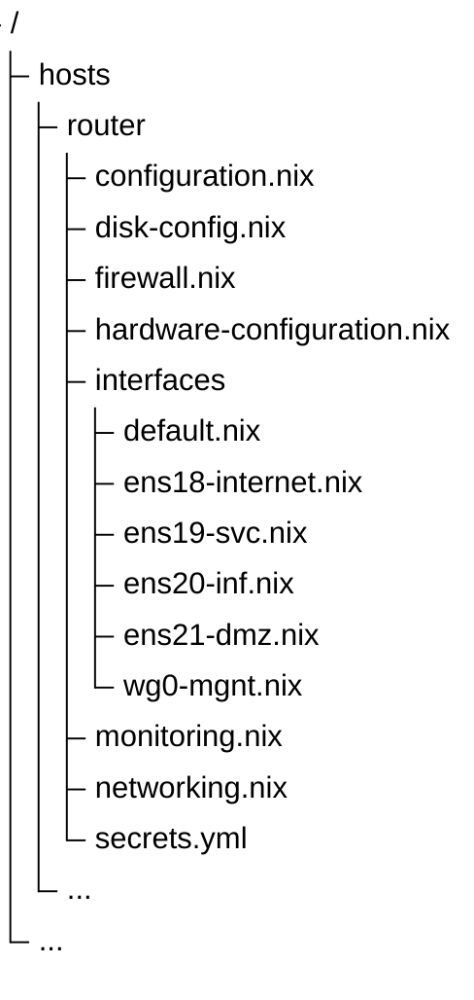

---
date:
  created: 2026-12-01
authors:
- nicof2000
- herrluisi
categories:
- NixOS
draft: True
---

# Server- und Netzwerkinfrastruktur mit NixOS (2/3)
Im Rahmen des ersten Artikels wurden eine Einführung in die Konfiguration von Servern mit
NixOS gegeben. Dieser Teil beschäftigt sich mit Strukturierung einer Infrastruktur,
komplett basierende auf NixOS.

Im Fokus liegen dabei:

- Netzwerksegmentierung
- Implementierung des Prinzips: Ein Dienst pro System
- GitOps (CI/CD Pipeline) mit
  [Forgejo](https://forgejo.org/) und
  [Gradient](https://github.com/wavelens/gradient)

<!-- more -->

## Kurzvorstellung der geplanten Infrastruktur
Folgendes Netzwerkdiagramm beschreibt den Aufbau schematisch:


Im Services (**SVC**) Netzsegment sind öffentlich erreichbare Dienste angesiedelt. Das im
vorherigen Teil des Blogartikel aufgesetzte System wird in die Systeme `notes` (hedgedoc)
und `auth` (keycloak) aufgeteilt.

Das Infrastruktur-Segment (**INF**) umfasst administrative Dienste. Während die Systeme
`git` und `build` für die Implementation von GitOps (forgejo, forgejo-actions und gradient)
genutzt werden, stellen `mon` und `log` die Monitoring (prometheus, grafana) bzw.
Log-Collection (graylog) dar.

In der demilitarisierten Zone (**DMZ**) werden Dienste bereitgestellt, die Systeme in den
isolierten Netzsegmenten (INF, SVC) ohne direkten Internetzugriff nutzen können, um
Informationen aus dem Internet abzurufen oder eigene Dienste erreichbar zu machen. Der
Server `proxy` stellt einen Forward-Proxy (squid) bereit, über den Systeme auf festgelegte
Internetseiten zugreifen können. Zusätzlich ermöglicht ein Reverse-Proxy (nginx) den Zugriff
aus dem Internet auf intern gehostete Dienste, die öffentlich erreichbar sein sollen
(hedgedoc, keycloak). Die Systeme `dns` und `time` stellen einen DNS Resolver (Knot Resolver)
sowie einen Zeitserver (chrony) zur Verfügung.

Der Router verbindet die Netzsegmente untereinander. Auf diese System werden strikte Firwallregeln
für die Weiterleitung von IP Paketen definiert. Sowohl für den Zugriff auf das Infra Segment, als
auch die Administration wird ein Wireguard Endpunkt auf dem Server bereitgestellt, mit dem sich
Clients aus dem Internet verbinden können.

## Strukturierung der NixOS Konfiguration
Eine Infrastruktur besteht selten nur aus einem einzigen System. Sobald mehrere Systeme verwaltet
werden müssen, stellt sich die Frage, wie die NixOS-Konfiguration sinnvoll organisiert werden
kann. NixOS eignet sich besonders gut dafür, als Infrastruktur as Code (IaC) in einem Git-Repository
abgelegt zu werden. Die Konfiguration aller Systeme kann dadurch versioniert, nachvollziehbar
geändert und reproduzierbar ausgerollt werden. Die flake.lock erhält die exakte Version der
verwendeten externen Quellen (wie z. B. nixpkgs). Eine einfache und gut erweiterbare Struktur
besteht aus einem Verzeichnis für die einzelnen Hosts und einem zweiten Verzeichnis für
wiederverwendbare Module (beispielsweise die Härtungskonfiguration).

Das folgende Beispiel beschreibt die hier genutzte Struktur:

```mermaid
treeView-beta
    ".git"
    "hosts"
        "auth"
            "configuration.nix"
            "disk-config.nix"
            "hardware-configuration.nix"
            "keycloak.nix"
            "secrets.yml"
        "build"
            "configuration.nix"
            "disk-config.nix"
            "gradient.nix"
            "hardware-configuration.nix"
            "secrets.yml"
        "dns"
            "configuration.nix"
            "disk-config.nix"
            "dns.nix"
            "hardware-configuration.nix"
            "secrets.yml"
        "git"
            "configuration.nix"
            "disk-config.nix"
            "forgejo.nix"
            "hardware-configuration.nix"
            "secrets.yml"
        "log"
            "configuration.nix"
            "disk-config.nix"
            "graylog.nix"
            "hardware-configuration.nix"
            "secrets.yml"
        "mon"
            "configuration.nix"
            "disk-config.nix"
            "grafana.nix"
            "hardware-configuration.nix"
            "prometheus.nix"
            "secrets.yml"
        "notes"
            "configuration.nix"
            "disk-config.nix"
            "hardware-configuration.nix"
            "hedgedoc.nix"
            "secrets.yml"
        "proxy"
            "configuration.nix"
            "disk-config.nix"
            "hardware-configuration.nix"
            "nginx.nix"
            "secrets.yml"
            "squid.nix"
        "time"
            "configuration.nix"
            "disk-config.nix"
            "hardware-configuration.nix"
            "secrets.yml"
            "time.nix"
    "modules"
        "hardening.nix"
    ".sops.yaml"
```

<!--
TODO: Inline Descriptions und Logos funktionieren nicht, siehe:
https://mermaid.ai/open-source/syntax/treeView.html#inline-descriptions-with

-->

Der Befehl `nixos-rebuild` erlaubt auch die Definition eines Zielhosts, somit lässt sich
die Konfiguration eines Servers auch von einem Client aus verändern. Das git-Repository
muss daher nicht auf jeden Server kopiert und aktuell gehalten werden.

Um beispielsweise das System "notes" zu deployen wird folgender Befehl genutzt.
```
sudo nixos-rebuild switch \
  --flake .#notes \
  --target-host nico@192.168.1.10 \
  --sudo
```

Im NixOS-Ökosystem existieren viele verschiedenen Deploy Tools, die
die Erstellung einer Deploy-Konfiguration (z.B. IP des Zielsystem) erlauben.
Beispiele dafür sind [deploy-rs](https://github.com/serokell/deploy-rs),
[deploy-sh](https://radicle.defelo.de/nodes/radicle.defelo.de/rad:z392ZFR7AcScpaQqmTKUDkDj9FWMq)
und [colmena](https://github.com/nix-community/colmena).

Im Rahmen dieses Blogartikels wird auf kein externes Deploy Tool zurückgegriffen, sondern
`nixos-rebuild` wie oben beschrieben verwendet.

## Implementierung
### Router
Neben den Standard-Konfigurationsdateien verfügt der Router aufgrund seiner höheren
Komplexität über eine separate Datei für die Firewallkonfiguration. Darin werden
neben nftables Definitionen und Sets auch die Regeln für die Weiterleitung von
Paketen (FORWARD) festgelegt.

Für eine bessere Übersichtlichkeit wird jede Netzwerkschnittstelle in einer eigenen
Datei konfiguriert. Neben der Schnittstellenkonfiguration mit ifstate werden dort
auch die Firewallregeln für INPUT und OUTPUT definiert. Dabei greifen wir auf die
in firewall.nix definierten Aliase zurück.


#### Interne Netzwerkschnittstelle

Eine interne Netzwerkschnittstelle sieht dann beispielsweise so aus:
```nix
# hosts/router/interfaces/ens20-inf.nix
let
  interface = "ens20";
in
{
  networking = {
    ifstate.settings.interfaces."${interface}" = {
      addresses = [ "192.168.1.1/24" ];
      alt-names = [ "inf" ];
      link = {
        state = "up";
        kind = "physical";
        address = "01:23:45:67:89:ab";
      };
    };
    nftables.tables.nixos-fw.content = ''
      chain input-allow {
        # ci/cd pipeline on build deploys this host
        iifname ${interface} ip saddr @build4 tcp dport 22 accept
        iifname ${interface} ip6 saddr @build6 tcp dport 22 accept
      }
    '';
  };
}
```

#### Firewall

In der Firewallkonfiguration finden sich dann die sets sowie Weiterleitungsregeln:
```nix
# hosts/router/firewall.nix
{
  networking.nftables.tables.nixos-fw.content = ''
    set build4 {
      type ipv4_addr
      elements = { 192.168.1.10 }
    }
    set build6 {
      type ipv6_addr
      elements = { fd00::192:168:1:10 }
    }

    # ...

    chain forward-allow {
      # build -> git, to get git repos
      ip saddr @build4 ip daddr @git4 tcp dport { 22, 443 } accept
      ip6 saddr @build6 ip6 daddr @git6 tcp dport { 22, 443 } accept

      # ...
    }
  '';
}
```

#### Wireguard

Der Wireguard Endpunkt benötigt verschiedene Secrets (Private Key, Preshared Key für
jeden Client) Diese werden über sops verwaltet, auf dem System als Datei bereitgestellt
und dann in ifstate mit `!include path` geladen.
```nix
# hosts/router/interfaces/wg0-mgnt.nix
{ config, ... }:
let
  interface = "wg0";
in
{
  sops.secrets = {
    "wireguard/priv" = { };
    "wireguard/psk/nico" = { };
    "wireguard/psk/luis" = { };
  };

  networking = {
    ifstate.settings.interfaces."${interface}" = {
      addresses = [ "192.168.4.1/24" ];
      link = {
        state = "up";
        kind = "wireguard";
      };
      wireguard = {
        private_key = "!include ${config.sops.secrets."wireguard/priv".path}";
        peers = {
          # nico
          "SMFlR8I+YU0iUhXRXfi9ig4phFlQJ64gonna1SrELmw=" = {
            preshared_key = "!include ${config.sops.secrets."wireguard/psk/nico".path}";
            allowedips = [ "192.168.4.2/32" ];
          };
          # luis
          "aJ8a8N0YAbY5iQTSWf52Fc4pStFfqPLp+BE0JV6fj3g=" = {
            preshared_key = "!include ${config.sops.secrets."wireguard/psk/luis".path}";
            allowedips = [ "192.168.4.3/32" ];
          };
        };
      };
    };

    nftables.tables.nixos-fw.content = ''
      chain input-allow {
        iifname ${interface} tcp dport 22 accept
      }
    '';
  };
}
```
Des Weiteren ist zu bedenken, dass der von Wiregaurd verwendete Port (hier: 51820)
aus dem Internet erreichbar sein muss. Dafür fügen wir in der Konfiguration der
Netzwerkschnittstelle ens18 eine Firewallregel ein, welche eingehende Anfragen
erlauben.

#### Internet
```nix
# hosts/router/interfaces/ens18-internet.nix
let
  interface = "ens18";
in
{
  networking = {
    ifstate.settings = {
      interfaces."${interface}" = {
        addresses = [ "192.168.0.2/24" ];
        alt-names = [ "internet" ];
        link = {
          state = "up";
          kind = "physical";
          address = "12:34:56:78:9a:bc";
        };
      };
      routing.routes = [
        {
          to = "0.0.0.0/0";
          via = "192.168.0.1";
        }
      ];
    };
    nftables.tables.nixos-fw.content =
      let
        wg0Port = toString config.networking.ifstate.settings.interfaces.wg0.listen_port;
      in
      ''
        chain input-allow {
          # wireguard
          iifname ${interface} ip daddr @routerPublic4 udp dport ${wg0Port} accept
          iifname ${interface} ip6 daddr @routerPublic6 udp dport ${wg0Port} accept
        }
      '';
  };
}
```
Hier nutzen wir einen der Vorteile von Nix: In der Konfiguration können wir auf andere Konfigurationselemente zugreifen.
Statt den Port statisch festzulegen, beziehen wir ihn über config aus der bestehenden Konfiguration. Ändert sich der Port,
muss er dadurch nur an einer Stelle angepasst werden.

### Monitoring
Mit zunehmender Anzahl an Servern gewinnt auch das Monitoring
an Bedeutung. Es liefert einen Überblick über den Zustand und
die Verfügbarkeit der Systeme und hilft dabei, Probleme frühzeitig
zu erkennen. Dabei können beispielsweise die CPU- und RAM-Auslastung,
der verfügbare Speicherplatz, die Erreichbarkeit von Diensten sowie
die Gültigkeit von TLS-Zertifikaten überwacht werden.

Für die Umsetzung eines Monitorings existieren verschiedene Ansätze.
Beim Push-Modell senden überwachte Systeme ihre Metriken aktiv an eine
zentrale Monitoring-Instanz. Beim Pull-Modell werden die Metriken
hingegen von der Monitoring-Instanz regelmäßig bei den überwachten
Systemen abgefragt. Entsprechend vielfältig ist auch die Auswahl
an verfügbaren Werkzeugen.

In diesem Kapitel wird die Implementierung eines Pull-basierten
Monitorings mit Prometheus beschrieben. Wie bereits bei der
Systemhärtung dienen die folgenden Beispiele lediglich als Anregung
und stellen keine vollständige Monitoring-Konfiguration dar. Welche
Metriken erfasst und welche Benachrichtigungen eingerichtet werden,
hängt stark von der jeweiligen Umgebung und den individuellen Anforderungen
ab. Besonders bei der Definition von Alerts gibt es zahlreiche Möglichkeiten
von einfachen Schwellwerten bis hin zu komplexen, aus mehreren Metriken
abgeleiteten Regeln.

```nix
{
  services.prometheus = {
    enable = true;
    scrapeConfigs = [
      {
        job_name = "prometheus";
        static_configs = [ { targets = [ "localhost:9090" ]; } ];
      }
    ];
  };
}
```

#### Prometheus Exporter
Auf der Prometheus-Website findet sich eine umfangreiche Übersicht
verschiedener Exporter, die auf Systemen installiert werden können,
um Metriken für Prometheus bereitzustellen:
<https://prometheus.io/docs/instrumenting/exporters/>.

Besonders hervorzuheben sind der offizielle node_exporter und der
blackbox_exporter.

node_exporter stellt Hardware- und Betriebssystemmetriken bereit. Dazu gehören
beispielsweise Informationen zur CPU- und Speicherauslastung, zu Dateisystemen,
Netzwerkverbindungen und Systemlast.
```nix
{
  services.prometheus.exporters.node = {
    enable = true;
    enabledCollectors = [ "systemd" ];
  };
}
```
Auf dem Monitoring System wird dann die entsprechende Scrape Config hinzugefügt:
```nix
{
  services.prometheus.scrapeConfigs = [
    {
      job_name = "node-exporter";
      static_configs = [
        {
          targets = [
            "notes.example.com:9100"
            "auth.example.com:9100"
            "monitoring.example.com:9100"
          ];
        }
      ];
      relabel_configs = [
        {
          source_labels = [ "__address__" ];
          regex = "([^:]+):\\d+";
          target_label = "instance";
        }
      ];
    }
  ];
}
```

Der blackbox_exporter prüft die Erreichbarkeit und das Verhalten externer
Endpunkte, indem er sogenannte Blackbox-Probes durchführt. Unterstützt
werden unter anderem Prüfungen über HTTP, HTTPS, DNS, TCP, ICMP und gRPC.
Dadurch lässt sich beispielsweise feststellen, ob ein Webserver erreichbar
ist, ein DNS-Dienst korrekt antwortet oder ein TLS-Zertifikat noch gültig
ist. Da dieser Dienst nicht primär den Zustand des Systems überwacht,
auf dem er ausgeführt wird, wird er auf dem Monitoring-System deployed.
```nix
{
  services.prometheus = {
    exporters.blackbox = {
      enable = true;
      listenAddress = "127.0.0.1";
      configFile = pkgs.writeText "blackbox.yml" ''
        modules:
          http_2xx:
            prober: http
      '';
    };

    scrapeConfigs = [
      {
        job_name = "blackbox-exporter";
        static_configs = [ { targets = [ "127.0.0.1:9115" ]; } ];
      }
      {
        job_name = "blackbox-exporter_http";
        metrics_path = "/probe";
        params.module = [ "http_2xx" ];
        static_configs = [
          {
            targets = [
              "notes.example.com"
              "auth.example.com"
            ];
          }
        ];
        relabel_configs = [
          {
            source_labels = [ "__address__" ];
            target_label = "__param_target";
          }
          {
            source_labels = [ "__param_target" ];
            target_label = "instance";
          }
          {
            target_label = "__address__";
            replacement = "127.0.0.1:9115";
          }
        ];
      }
    ];
  };
}
```

#### Alertmanager
Prometheus kann auf Grundlage der gesammelten Metriken Alert-Regeln
auswerten. Für die weitere Verarbeitung und Zustellung der ausgelösten
Alarme ist Alertmanager zuständig. Im folgenden wird eine Regel
implementiert, die einen Alarm auslöst, wenn ein Dateisystem bereits
weniger als zehn Prozent freien Speicherplatz besitzt und bei
gleichbleibender Schreibrate voraussichtlich innerhalb der nächsten 24
Stunden vollständig belegt sein wird.
```nix
{
  services.prometheus = {
    rules = [
      (
        builtins.toJSON
        {
          groups = [
            {
              name = "custom";
              rules = [
                {
                  alert = "HostDiskWillFillIn24Hours";
                  expr = ''
                    ((node_filesystem_avail_bytes * 100) / node_filesystem_size_bytes < 10 and ON (instance, device, mountpoint) predict_linear(node_filesystem_avail_bytes{fstype!~"tmpfs"}[1h], 24 * 3600) < 0 and ON (instance, device, mountpoint) node_filesystem_readonly == 0) * on(instance) group_left (nodename) node_uname_info{nodename=~".+"}
                  '';
                  for = "20m";
                  labels = {
                    severity = "warning";
                  };
                  annotations = {
                    summary = "Host disk will fill in 24 hours (instance {{ $labels.instance }})";
                    description = "Filesystem is predicted to run out of space within the next 24 hours at current write rate\n  VALUE = {{ $value }}\n  LABELS = {{ $labels }}";
                  };
                }
              ];
            }
          ];
        }
      )
    ];
    alertmanager = {
      enable = true;
      configuration = {
        route = {
          group_wait = "10s";
          group_interval = "30s";
          repeat_interval = "1d";
          receiver = "default";

          routes = [
            {
              receiver = "default";
              match_re = {
                severity = "critical";
              };
              continue = true;
            }
          ];
        };
        receivers = [
          {
            name = "default";
            email_configs = [ "monitoring-alerts@example.com" ];
          }
        ];
      };
    };
  };
}
```

#### Grafana
Zur Visualisierung der mit Prometheus gesammelten Metriken kann Grafana
eingesetzt werden. Die Plattform ermöglicht es, Metriken in übersichtlichen
Dashboards darzustellen, Zeitreihen zu analysieren und relevante
Entwicklungen oder Auffälligkeiten schnell zu erkennen.

```nix
{ config, ... }:
{
  sops.secrets."monitoring/grafana/secretKey".owner = "grafana";

  services = {
    grafana = {
      enable = true;
      settings = {
        server = {
          domain = "grafana.example.com";
          root_url = "https://%(domain)s/";
        };
        security.secret_key = "$__file{${config.sops.secrets."monitoring/grafana/secretKey".path}}";
      };
      provision = {
        enable = true;
        datasources.settings.datasources = [
          {
            name = "Prometheus";
            type = "prometheus";
            url = "http://127.0.0.1:9090";
            isDefault = true;
          }
        ];
      };
    };

    nginx = {
      enable = true;
      virtualHosts."grafana.example.com" = {
        locations."/" = {
          proxyPass = "http://127.0.0.1:3000/";
          proxyWebsockets = true;
        };
        enableACME = true;
        forceSSL = true;
      };
    };
  };
}
```

Wie hedgedoc verwendet auch Grafana Standardmäßig eine sqlite Datenbank.
In dieser werden zwar primär Benutzer und Dashboards gespeichert, dennoch
sollte diese gesichert werden
```nix
{
  services = {
    postgresql = {
      enable = true;
      ensureDatabases = [ "grafana" ];
    };
    grafana.database = {
      type = "postgres";
      host = "/run/postgresql";
      user = "grafana";
    };
  };
}
```

<!--
TODO
Des Weiteren kann auch Grafana an die zuvor eingerichtete Keycloak Instanz
angebunden werden.
```nix
{
  services.grafana.settings = {
    "auth.generic_oauth" = {
      enabled = true;
      name = "Keycloak";
      allow_sign_up = true;
      client_id = "grafana";
      client_secret = "$__file{${config.sops.secrets."monitoring/grafana/oidcSecret".path}}";
      scopes = "email profile roles openid";
      email_attribute_path = "email";
      login_attribute_path = "preferred_username";
      name_attribute_path = "full_name";
      auth_url = "https://grafana.example.com/realms/main/protocol/openid-connect/auth";
      token_url = "https://grafana.example.com/realms/main/protocol/openid-connect/token";
      api_url = "https://grafana.example.com/realms/main/protocol/openid-connect/userinfo";
      role_attribute_path = "contains(roles[*], 'admin') && 'Admin' || contains(roles[*], 'editor') && 'Editor' || 'Viewer'";
    };
  };
}
```
-->

In Grafana selbst (Zugangsdaten: admin:admin) können anschließend die
gewünschten Dashboards importiert beziehungsweise erstellt werden. Beispiele für
von mir verwendete Dashboards können <https://github.com/secshellnet/grafana-dashboards>
entnommen werden.