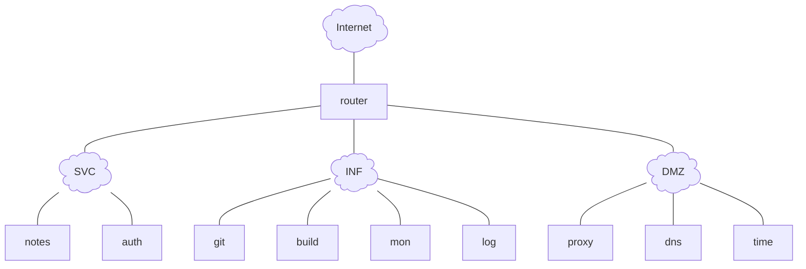
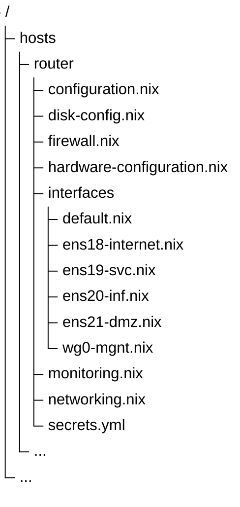

---
date:
  created: 2026-10-14
authors:
- nicof2000
categories:
- NixOS
draft: True
---

# Server- und Netzwerkinfrastruktur mit NixOS (2/3)
Im Rahmen des ersten Artikels wurden eine Einführung in die Konfiguration von Servern mit
NixOS gegeben. Dieser Teil beschäftigt sich mit Strukturierung einer Infrastruktur,
komplett basierende auf NixOS.

Im Fokus liegen dabei:
- Netzwerksegmentierung
- Implementierung des Prinzips: Ein Dienst pro System
- GitOps (CI/CD Pipeline) mit
  [Forgejo](https://forgejo.org/) und
  [Gradient](https://github.com/wavelens/gradient)

<!-- more -->

## Kurzvorstellung der geplanten Infrastruktur
Folgendes Netzwerkdiagramm beschreibt den Aufbau schematisch:


Im Services (**SVC**) Netzsegment sind öffentlich erreichbare Dienste angesiedelt. Das im
vorherigen Teil des Blogartikel aufgesetzte System wird in die Systeme `notes` (hedgedoc)
und `auth` (keycloak) aufgeteilt.

Das Infrastruktur-Segment (**INF**) umfasst administrative Dienste. Während die Systeme
`git` und `build` für die Implementation von GitOps (forgejo, forgejo-actions und gradient)
genutzt werden, stellen `mon` und `log` die Monitoring (prometheus, grafana) bzw.
Log-Collection (graylog) dar.

In der demilitarisierten Zone (**DMZ**) werden Dienste bereitgestellt, die Systeme in den
isolierten Netzsegmenten (INF, SVC) ohne direkten Internetzugriff nutzen können, um
Informationen aus dem Internet abzurufen oder eigene Dienste erreichbar zu machen. Der
Server `proxy` stellt einen Forward-Proxy (squid) bereit, über den Systeme auf festgelegte
Internetseiten zugreifen können. Zusätzlich ermöglicht ein Reverse-Proxy (nginx) den Zugriff
aus dem Internet auf intern gehostete Dienste, die öffentlich erreichbar sein sollen
(hedgedoc, keycloak). Die Systeme `dns` und `time` stellen einen DNS Resolver (Knot Resolver)
sowie einen Zeitserver (chrony) zur Verfügung.

Der Router verbindet die Netzsegmente untereinander. Auf diese System werden strikte Firwallregeln für die Weiterleitung von IP Paketen definiert. Sowohl für den Zugriff auf das Infra Segment, als auch die Administration wird ein Wireguard Endpunkt auf dem Server bereitgestellt, mit dem sich Clients aus dem Internet verbinden können.

## Randbedingungen
- Alle Systeme werden in einem git-Repository gepflegt und entsprechend der Struktur
  aus dem vorherigen Artikel definiert.
- Das Deployment erfolgt über `nixos-rebuild`.
- Die gesamte finale Konfiguration kann unter
  [TODO_HIER_URL_EINFÜGEN](https://TODO_HIER_URL_EINFÜGEN) eingesehen werden. Die
  folgenden Kapitel enthalten lediglich relevante Ausschnitte.

## Implementierung
### Router
Neben den Standard-Konfigurationsdateien verfügt der Router aufgrund seiner höheren
Komplexität über eine separate Datei für die Firewallkonfiguration. Darin werden
neben nftables Definitionen und Sets auch die Regeln für die Weiterleitung von
Paketen (FORWARD) festgelegt.

Für eine bessere Übersichtlichkeit wird jede Netzwerkschnittstelle in einer eigenen
Datei konfiguriert. Neben der Schnittstellenkonfiguration mit ifstate werden dort
auch die Firewallregeln für INPUT und OUTPUT definiert. Dabei greifen wir auf die
in firewall.nix definierten Aliase zurück.


Eine interne Netzwerkschnittstelle sieht dann beispielsweise so aus:
```nix
# hosts/router/interfaces/ens20-inf.nix
let
  interface = "ens20";
in
{
  networking = {
    ifstate.settings.interfaces."${interface}" = {
      addresses = [ "192.168.1.1/24" ];
      alt-names = [ "inf" ];
      link = {
        state = "up";
        kind = "physical";
        address = "01:23:45:67:89:ab";
      };
    };
    nftables.tables.nixos-fw.content = ''
      chain input-allow {
        # ci/cd pipeline on build deploys this host
        iifname ${interface} ip saddr @build4 tcp dport 22 accept
        iifname ${interface} ip6 saddr @build6 tcp dport 22 accept
      }
    '';
  };
}
```

Der Wireguard Endpunkt benötigt verschiedene Secrets (Private Key, Preshared Key für
jeden Client) Diese werden über sops verwaltet, auf dem System als Datei bereitgestellt
und dann in ifstate mit `!include path` geladen.
```nix
# hosts/router/interfaces/wg0-mgnt.nix
{ config, ... }:
let
  interface = "wg0";
in
{
  sops.secrets = {
    "wireguard/priv" = { };
    "wireguard/psk/nico" = { };
    "wireguard/psk/luis" = { };
  };

  networking = {
    ifstate.settings.interfaces."${interface}" = {
      addresses = [ "192.168.4.1/24" ];
      link = {
        state = "up";
        kind = "wireguard";
      };
      wireguard = {
        private_key = "!include ${config.sops.secrets."wireguard/priv".path}";
        peers = {
          # nico
          "SMFlR8I+YU0iUhXRXfi9ig4phFlQJ64gonna1SrELmw=" = {
            preshared_key = "!include ${config.sops.secrets."wireguard/psk/nico".path}";
            allowedips = [ "192.168.4.2/32" ];
          };
          # luis
          "aJ8a8N0YAbY5iQTSWf52Fc4pStFfqPLp+BE0JV6fj3g=" = {
            preshared_key = "!include ${config.sops.secrets."wireguard/psk/luis".path}";
            allowedips = [ "192.168.4.3/32" ];
          };
        };
      };
    };

    nftables.tables.nixos-fw.content = ''
      chain input-allow {
        iifname ${interface} tcp dport 22 accept
      }
    '';
  };
}
```
Des Weiteren ist zu bedenken, dass der von Wiregaurd verwendete Port (hier: 51820)
aus dem Internet erreichbar sein muss. Dafür fügen wir in der Konfiguration der
Netzwerkschnittstelle ens18 eine Firewallregel ein, welche eingehende Anfragen
erlauben.
