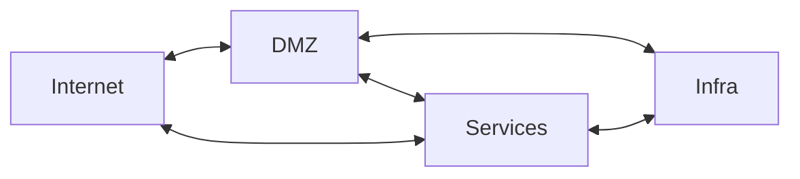

---
date:
  created: 2027-01-01
authors:
- nicof2000
- herrluisi
categories:
- NixOS
draft: True
---

# Server- und Netzwerkinfrastruktur mit NixOS (3/3)

Der in Teil 2 implementierte Router verwendet lediglich die Globale Routingtabelle -> jetzt machen wir VRF's um L3 Isolierung zu haben!

Mithilfe von verschiedenen VRF's werden vier Routingdomainen erstellt.
Die jeweils notwendigen Routen werden in die entsprechenden VRF's geleaked.

Infrastruktursysteme sind dazu zur Nutzung der in der DMZ angesiedelten
Dienste (proxy, dns, time) verpflichtet um das Internet zu erreichen.
Auf dem Proxy können für jedes System spezifische Policies implementiert
werden, welche die benötigten Zugriffe erlauben.

Auch Systeme in der Services VRF sollten sofern Möglich die Systeme der
DMZ nutzen. Für nicht HTTP Dienste ist dies jedoch nicht immer möglich. (oder? )

ggf. kann man dann auch vrrp mal testen?
